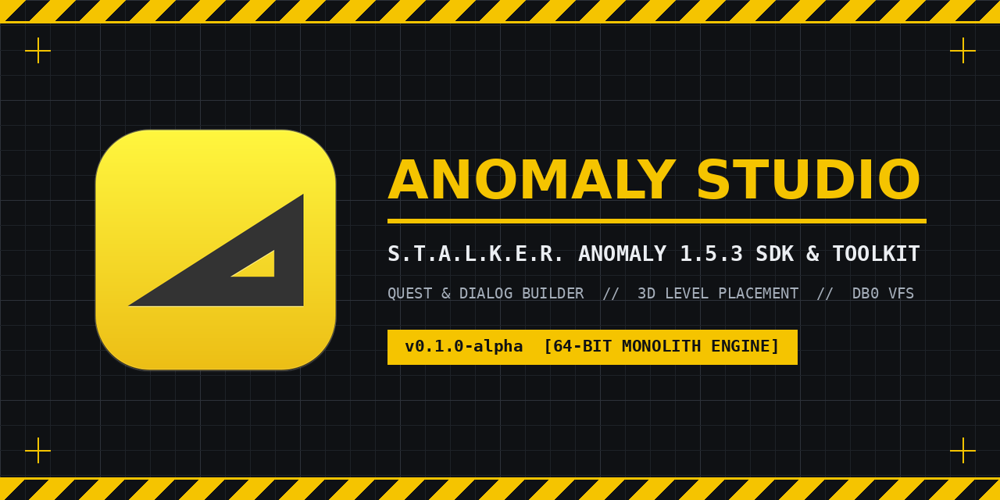

# S.T.A.L.K.E.R. Anomaly 1.5.3 Studio (`v0.1.0-alpha` — Tech Demo)



**Official Discord:** [Join the Anomaly Studio Discord](https://discord.gg/dCGf3zP8fR) · **Latest Download:** [GitHub Releases (`v0.1.0-alpha`)](https://github.com/EternalPainModding/anomaly-153-studio/releases/tag/v0.1.0-alpha) · **Author:** `EternalPain`

> **Early Alpha / Tech Demo Notice (`v0.1.0-alpha`)**  
> This release is an **early Alpha build and technical preview**, not a finished SDK. Expect rough edges and unfinished features. Always back up your `gamedata/` folder, savegames, and Mod Organizer 2 profiles before testing exported mods in-game.

---

## What is Anomaly Studio?

**Anomaly Studio** is a standalone, open-source modding tool built specifically for **S.T.A.L.K.E.R. Anomaly 1.5.3** (**64-bit Monolith Engine**).

Normally, modding Anomaly requires unpacking tens of gigabytes of `.db0` archives first. Anomaly Studio reads the `.db0` files directly from your Anomaly 1.5.3 folder in read-only mode and exports your work as a clean `.db0` archive or a ready-to-install **Mod Organizer 2 (`.zip`)** mod package.

---

## Quick Start

### 1. Download & Unpack
Go to [**Releases (`v0.1.0-alpha`)**](https://github.com/EternalPainModding/anomaly-153-studio/releases/tag/v0.1.0-alpha) and download the archive for your system:
- **Windows (`x86_64`):** Download `Anomaly_Studio_v0.1.0-alpha_Windows_x86_64.zip`, extract it anywhere, and launch **`AnomalyStudio.exe`**.
- **Linux (`x86_64`):** Download `Anomaly_Studio_v0.1.0-alpha_Linux_x86_64.tar.gz`, extract it, and launch **`./AnomalyStudio`**.

### 2. Set Your Anomaly 1.5.3 Folder (First Launch)
1. Click **Paths & Settings** in the top bar.
2. Select your **S.T.A.L.K.E.R. Anomaly 1.5.3** root folder (the folder that contains `db/` and `bin/`).
3. *(Optional)* Select your **Mod Organizer 2 (MO2)** folder if you want to load active mods or export directly into your MO2 `mods/` folder.
4. Click **Save & Mount VFS**. Anomaly Studio will immediately index all 68 `.db0` archives in the background.

### 3. First Steps in the Editor
- **Tab 1 — Story, Dialog & Quest Builder:** Create or edit quests and NPC dialogs in a visual node graph (`Drag & Drop` to connect lines, `Click` a wire to disconnect), edit conditions in the right-hand Inspector, or pick 3D target coordinates directly from the map.
- **Tab 2 — 3D World & Object Placement:** Pick any Anomaly level (e.g. `l01_escape`), move around with **`WASD` + Right-Click Mouse Look**, click any 3D object or spawn to inspect it, or place new `.ogf` objects with **Snap to Ground (`G`)** and **Surface Normal (`N`)**.
- **Tab 3 — 3D Asset & `.OGF` Viewer:** Browse and preview `.ogf` models and `.dds` textures directly from the `.db0` archives.
- **Tab 4 — `.db0` Packer & Pre-Flight Check:** Run **Spawn & Load Check** to verify your changes in the bottom Console, then export your mod as a `.db0` file or MO2 `.zip` package.

<details>
<summary><b>Running from Source (Optional — Python 3.10+)</b></summary>

If you prefer running directly from the repository instead of the standalone release archive:
```bash
# Launch native desktop window (Linux GTK/WebKit2):
python3 backend/native_desktop_app.py

# Or launch local web mode on http://127.0.0.1:8780 (Windows / Linux):
python3 backend/server.py
```
</details>

---

## Current Features in `v0.1.0-alpha` (Tech Demo)

- **Direct `.db0` Virtual File System (VFS):** Streams levels, `.ogf` meshes, `.dds` textures, `.ltx` configs, and `.xml` dialogs directly from Anomaly's `db/*.db0` archives without unpacking.
- **Visual Quest & Dialog Graph (Tab 1):** Drag-and-drop node connections, resizable property inspector, pre-flight syntax & softlock checks, and 3D map target picker (`LVID` / `GVID`).
- **3D Level & Placement Preview (Tab 2):** Renders `level.cform` collision geometry, `level + level.geom` textured static meshes, 3D trees, `level.ai` navigation nodes, and `.ogf` spawns with a 3D Transform Gizmo (`Move`, `Rotate`, `Scale`, `Snap to Ground [G]`, `Surface Normal [N]`, `Grid Snap`) and automatic `alife_create` Lua spawn script generation.
- **`.OGF` Viewer & `.db0` / MO2 Exporter (Tabs 3 & 4):** Live `.ogf` + `.dds` model preview, pre-flight validation console, `Ctrl+Z` / `Ctrl+Y` Undo/Redo, crash-recovery autosave, and standalone `.db0` / `.zip` export.
- **Interface Languages:** English (`EN` primary) + Russian (`RU (Exp)` experimental preview).

---

## Credits & Community

- **Author & Lead Developer:** `EternalPain`
- **Discord Community & Bug Reports:** [Join the Anomaly Studio Discord](https://discord.gg/dCGf3zP8fR)
